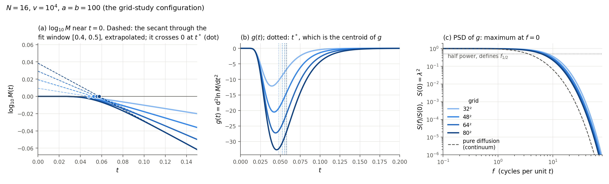
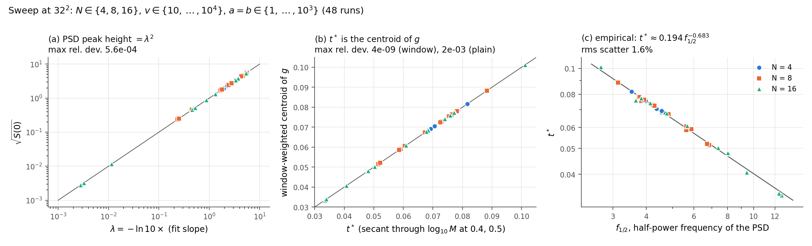
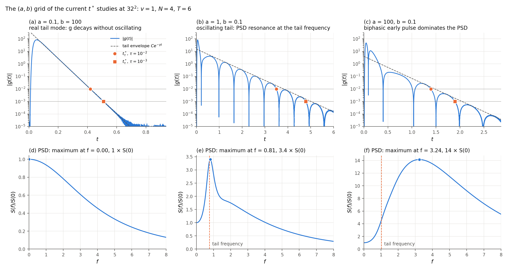
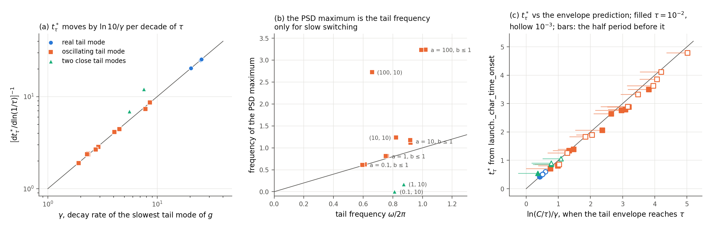

# Power spectral density of d²/dt² ln M(t), and the characteristic time

The question: take the total mass M(t), compute the power spectral density (PSD) of

$$g(t) = \frac{d^2}{dt^2}\ln M(t),$$

find its peak, and relate it to the characteristic time t\*.

**The full write-up, with derivations, is
[`findings/psd_d2_ln_mass_report.pdf`](../../findings/psd_d2_ln_mass_report.pdf).**
This README summarises it.

The project has had two definitions of t\*, and both are covered:

- **t\*_sec**, the original: a secant through log₁₀ M at t = 0.4 and 0.5,
  extrapolated to M = 1. In force until 2026-09-28 and used by the grid study.
- **t\*_τ**, the current one (`launch._char_time_onset`): the first sample after
  the last one with |g| > τ.

## Short answer

1. **The value of the PSD at f = 0 is exactly λ²**, where λ is the asymptotic
   decay rate: λ = −ln 10 × (fit slope), the slope either kernel records. In 49
   sweep runs √S(0) matched λ to within 5.6 × 10⁻⁴ (median 4 × 10⁻⁶).
2. **When the escape rate rises monotonically (g ≤ 0), the PSD peaks at f = 0.**
   This is a theorem, and it held in every a = b run.
3. **t\*_sec is the centroid of g:** t\* = ∫ t g dt / ∫ g dt. With the fit
   window's weighting included the identity is exact; it holds to 4 × 10⁻⁹ in
   every run.
4. **A PSD cannot contain t\*_sec itself.** t\*_sec is a position in time, and a
   PSD does not change when the signal is shifted in time. t\*_sec sits in the
   *phase* of the spectrum, as the group delay at f = 0. The PSD's *width* does
   track it closely, but only empirically: t\* ≈ 0.194 f½^−0.683, with 1.6 % rms
   scatter, where f½ is the half-power frequency.
5. **t\*_τ is set by the slowest transient mode of g's tail**,
   g ~ C e^(−γt) cos(ωt). For a real mode t\*_τ = ln(C/τ)/γ exactly, and for an
   oscillating one it falls within half a period of that. So t\*_τ moves by
   ln 10/γ per decade of τ.
6. **With slow switching onto the advective layer (b ≤ 1), g changes sign and the
   PSD peaks at f > 0**, reaching up to 14 S(0). That peak is the tail frequency
   ω/2π only for a ≤ 1. For larger a it comes from a biphasic early pulse and sits
   up to 3× higher. See [the (a, b) grid](#the-current-t-on-the-a-b-grid).
7. **Off-the-shelf PSD estimators show a misleading peak at a nonzero frequency.**
   `scipy.signal.periodogram` puts its maximum at f = 1/T, and `welch` puts it at
   its first nonzero frequency bin. Both come from the estimators' conventions,
   not the physics, and both move if T or the segment length changes. See
   [Caveats](#caveats).



*(a) The t\* construction. (b) g(t) is a single negative pulse, and t\* (dotted)
sits at its centroid. (c) Its PSD, normalised by S(0) = λ². The grid-study
configuration is shown at increasing resolution, with continuum pure diffusion
(dashed) for reference.*

## Derivation

**Notation.** ℓ(t) = ln M(t). κ(t) = −ℓ′(t) is the escape rate per surviving
particle (the hazard rate), so g = ℓ″ = −κ′. Two properties of the setup are used
throughout:

- **M(0) = 1**, so ℓ(0) = 0.
- **κ(0) = 0.** The initial condition is centred, so at t = 0 no mass sits on the
  absorbing boundary and nothing has escaped yet.

At late times one mode dominates, so ℓ(t) → α − λt. The t\* kernel fits a secant
to log₁₀ M through t = 0.4 and t = 0.5 and takes its zero. Once the late-time form
holds, that zero is t\* = α/λ, and the fitted slope is −λ/ln 10.

**DC value.** Integrate g once:

$$\int_0^\infty g\,dt = \ell'(\infty)-\ell'(0) = -\lambda + \kappa(0) = -\lambda .$$

Since $G(f)=\int g\,e^{-2\pi i f t}\,dt$, this means **G(0) = −λ and S(0) = |G(0)|² = λ²
= (ln 10 · fit slope)².**

**Centroid.** Write ℓ = α − λt + u, where u and u′ go to 0 at large t, so that
u″ = g. Integrating by parts,

$$\int_0^\infty t\,g\,dt = \big[t\,u'\big]_0^\infty - \int_0^\infty u'\,dt = u(0) = \ell(0) - \alpha = -\alpha .$$

Dividing by the DC value gives **t\* = α/λ = ∫ t g dt / ∫ g dt**: the centroid of g.

**Exact version for the finite fit window.** This version needs no late-time
assumption. Because ℓ(0) = ℓ′(0) = 0, the function can be written as
ℓ(x) = ∫₀ˣ (x − s) g(s) ds. Substituting that into the secant's zero gives

$$t^* = \frac{\int_0^{x_2} \min(s,x_1)\,w(s)\,g(s)\,ds}{\int_0^{x_2} w(s)\,g(s)\,ds},
\qquad w(s)=\begin{cases}1 & s\le x_1\\ \frac{x_2-s}{x_2-x_1} & x_1<s\le x_2\\ 0 & s>x_2\end{cases}$$

with x₁ = 0.4 and x₂ = 0.5. When g has died out before x₁, which happens in every
run here, w = 1 wherever g is nonzero and this reduces to the plain centroid.

**What the spectrum holds.** Expand G for small f:

$$G(f) = -\lambda\Big[1 - 2\pi i f\,t^* - \tfrac{(2\pi f)^2}{2}\mu_2 + \dots\Big],\qquad
\mu_2 = \frac{\int t^2 g}{\int g}.$$

So:

- **Phase:** t\* is the group delay at zero frequency,
  t\* = −(1/2π) d arg G/df at f = 0.
- **Magnitude:** |G(f)|² = λ² [1 − (2πf)² σ² + O(f⁴)], with σ² = μ₂ − t\*². The
  curvature at DC gives the *spread* of g about t\*, not t\* itself.
- **Where the peak is:** if g ≤ 0 everywhere (κ rising monotonically), then
  |G(f)| ≤ ∫|g| dt = |G(0)|, with equality only at f = 0. **The maximum is
  therefore always at DC.** g changed sign in only 2 of the 49 runs (v = 10,
  a = b = 10, N = 8 and 16). Its positive part was at most 1.3 % of ∫|g|, too
  small to move the maximum.
- **Why the PSD can't give t\*:** shifting g by τ multiplies G by $e^{-2\pi i f\tau}$. That
  leaves |G|² unchanged and moves t\* by τ.

**Interpretation.** When κ rises monotonically, p(t) = −g(t)/λ is a probability
density: the distribution of times at which the escape rate switches on. t\* is
the mean of that distribution and σ its standard deviation. The PSD of g is λ²
times the squared magnitude of p's characteristic function.

**Continuum check.** Take pure diffusion from a point source at the centre of the
unit disc, with an absorbing rim and D = 1. Then
$M=\sum_n c_n e^{-j_n^2 t}$ with $c_n = 2/(j_n J_1(j_n))$, so $t^* = \ln c_1 / j_1^2$ = 0.081484
analytically. Numerically, the centroid of g is 0.081484 and √S(0) = 5.783186 =
j₁², as predicted. Here f½ = 3.624 and t\*·f½ = 0.2953.

## Numerical verification



The sweep has 48 runs at 32²: N ∈ {4, 8, 16}, v ∈ {10, 10², 10³, 10⁴},
a = b ∈ {1, 10, 10², 10³}, each run to T = 2. There is also one pure-diffusion run
(one microtubule, a = b = v = 0). Every run comes from the same CPU solver path as
`launch._char_time_point`.

| check | max relative deviation | median |
|---|---|---|
| √S(0) against λ from the fit slope | 5.6 × 10⁻⁴ | 4 × 10⁻⁶ |
| window-weighted centroid of g against the secant t\* | 3.9 × 10⁻⁹ | 1 × 10⁻¹¹ |
| plain centroid against t\* | 2.3 × 10⁻³ | 2 × 10⁻⁵ |
| group delay at f = 0 against t\* | 2.0 × 10⁻³ | 1.6 × 10⁻⁴ |
| PSD maximum at f = 0 | every run (49 sweep, 4 grid) | |

The plain centroid deviates most when decay is slow (N = 16, v = 10, a = b = 10³).
In that case g has not fully died out by t = 0.4, which the window-weighted form
accounts for.

The t\* recomputed here matches the solver's own value to within 2.5 × 10⁻⁴. The
difference has a specific cause: the kernel reads log₁₀ M at the samples nearest
0.4 and 0.5 but uses the nominal 0.4 and 0.5 in the slope. As a cross-check, the
grid-study configuration solved here gives t\* = 0.052357, 0.055390 and 0.057689
at 48², 64² and 80², each matching `results/2026-08-18_char-time-grid-study_N16`.

### The grid-study configuration under refinement

N = 16, v = 10⁴, a = b = 100, T = 1.

| grid | t\* | λ = √S(0) | S(0) = λ² | centroid of g | f½ | σ | t\*·f½ |
|---|---|---|---|---|---|---|---|
| 32² | 0.047915 | 0.4512 | 0.2036 | 0.047915 | 8.11 | 0.0174 | 0.388 |
| 48² | 0.052360 | 0.8498 | 0.7221 | 0.052360 | 7.23 | 0.0196 | 0.378 |
| 64² | 0.055390 | 1.2136 | 1.4727 | 0.055390 | 6.68 | 0.0213 | 0.370 |
| 80² | 0.057688 | 1.5358 | 2.3587 | 0.057688 | 6.29 | 0.0227 | 0.363 |

λ and t\* show the same non-convergence documented in the grid study, and the
spectral quantities inherit it. The identities hold exactly at every grid.

### Empirical link between the PSD width and t\*

Across the sweep, t\* ≈ 0.194 f½^−0.683, with 1.6 % rms scatter in log t\* and a
worst case of 5.7 %. The product t\*·f½ ranges from 0.274 to 0.425 (pure diffusion:
0.295). It is largest where active transport is strongest (N = 16, a = b = 10³,
v ≥ 10³). There, κ switches on more sharply relative to its delay: t\*/σ reaches
3.0, against 1.9 for pure diffusion.

Treat this as a correlation within this family, not a law. R = D = 1 throughout,
so the prefactor carries hidden units. It works because the pulse's width and its
delay are set by the same transport. The exact routes to t\* are the centroid and
the phase.

## The current t\* on the (a, b) grid

The current studies' configuration (v = 1, N = 4, (a, b) ∈ {0.1, 1, 10, 100}²),
run at 32² to T = 6, with the b = 0.1 column repeated at 48². Here t\*_τ is
computed by calling `launch._char_time_onset` on the same mass series.





- **S(0) = λ² still holds** against the current kernel's steady-segment slope,
  to 7 × 10⁻⁶ in all sixteen pairs.
- **Real tail modes** (the b = 100 column): t\*_τ = ln(C/τ)/γ to the third
  decimal, and the τ-sensitivity matches γ to 0.09 %.
- **Oscillating tail modes** (ten pairs): the τ-sensitivity matches γ to within
  6.3 %. In 19 of 20 cases t\*_τ falls within half a period before the envelope
  crossing; the 20th overshoots by 0.007.
- **Two pairs, (0.1, 10) and (1, 10), have two close tail modes** that beat
  against each other, and the single-mode description does not apply.
- **t\*_sec is negative for (10, 0.1), (10, 1), (100, 0.1) and (100, 1)** at 32²,
  the same four pairs as at 96². The window identity explains it: t\*_sec is a
  weighted centroid of g, which goes negative when a large positive lobe of g
  (an overshoot of the escape rate) falls inside the window.

Per-pair numbers are in `ab_metrics.csv` and in Table 3 of the report.

## Caveats

- **"PSD" here means the energy spectral density |G(f)|².** g is a transient, not
  a stationary signal. A periodogram differs from it only by the constant 1/T,
  which moves nothing.
- **Standard estimators show a false peak.** Run on g(t) over [0, 1],
  `scipy.signal.periodogram` peaks at f = 1, which is 1/T. Its one-sided
  convention doubles every bin except DC, so the first nonzero bin outscores DC
  whenever it lies well inside the flat top of the spectrum. `scipy.signal.welch`
  with default settings also removes the mean, which zeroes DC outright; it peaks
  at its first nonzero frequency bin, f = fs/nperseg. Both peaks move when T or the
  segment length changes, so neither is physical. Use the two-sided |G(f)|², as
  `spectrum()` in the script does.
- **How g is differenced.** M is sampled every 10⁻⁵ or less, far finer than any feature of
  ln M, so differencing at that spacing only amplifies round-off. The script keeps
  every k-th sample to reach a spacing of ~2 × 10⁻⁵ (exact, no filtering), then
  takes central differences. The moments ∫g and ∫tg are computed by integration
  by parts from ln M and its first derivative, so noise in g cannot bias them.
- **Required assumptions.** The identities need M(0) = 1 and κ(0) = 0. An
  off-centre initial condition next to the rim breaks κ(0) = 0; the centroid
  relation then becomes t\* = ∫ t g / (∫ g − κ(0)).

## Files

| File | |
|---|---|
| `psd_metrics.csv` | one row per a = b run: t\*, fit slope, λ, S(0), f_peak, f½, centroid, window-weighted centroid, group delay, σ, and the shape of g |
| `ab_metrics.csv` | one row per (a, b) run: t\*_τ at τ = 10⁻² and 10⁻³, the tail mode (γ, ω, C) and its envelope prediction, the PSD peak, and t\*_sec |
| `anatomy_grid_study_config.png` | ln M, g and the PSD for the grid-study configuration |
| `sweep_identities.png` | the identity checks and the empirical f½ relation |
| `ab_examples.png`, `ab_relations.png` | the (a, b) grid: three regimes, and the tail-mode relations |
| `tex/` | LaTeX table fragments the report includes, written by `report` |

## Reproducing

```bash
python scripts/psd_d2_ln_mass.py solve --set sweep   # 49 runs, ~2.5 min on 8 cores
python scripts/psd_d2_ln_mass.py solve --set grids   # 32²-80²; 80² is ~30 min
python scripts/psd_d2_ln_mass.py solve --set ab      # 16 pairs at 32², 4 at 48²
python scripts/psd_d2_ln_mass.py report              # CSVs, figures, tables here
cd findings && tectonic psd_d2_ln_mass_report.tex    # the PDF
```

The raw M(t) series are written to `data_output/psd_d2_ln_mass/raw/` (scratch, not
committed).
